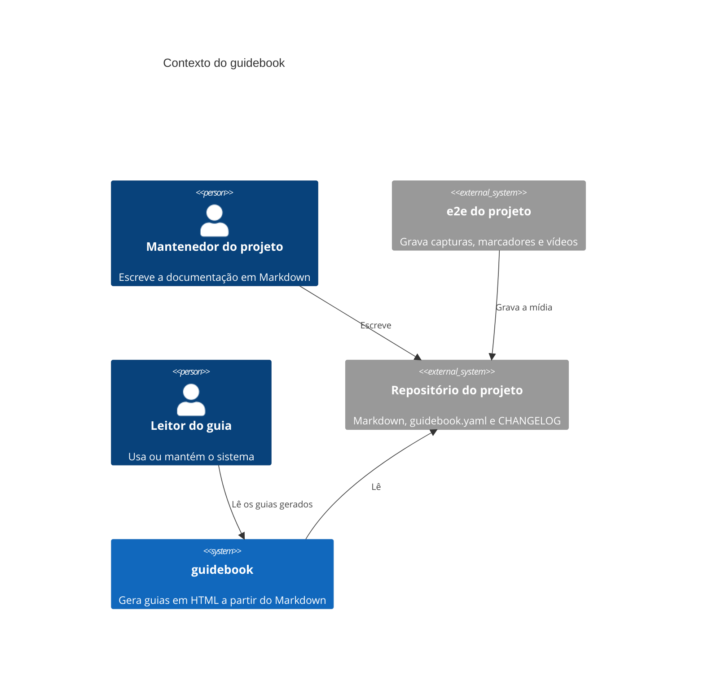
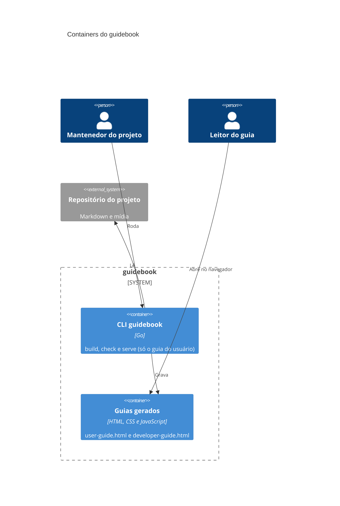

# Visão geral

O guidebook é uma linha de comando em Go. Ele lê o Markdown de um
projeto e grava dois guias em HTML, que abrem sem servidor e sem
internet. A especificação completa está em [docs/spec.md](../spec.md).

## Contexto

## Containers

## Pacotes

O código fica em `cmd/` e `internal/`:

| Pacote | Responsabilidade |
|---|---|
| `cmd/guidebook` | linha de comando: `build`, `check` e `version` |
| `internal/config` | leitura e validação do `guidebook.yaml` |
| `internal/content` | páginas, links, imagens, marcadores, vídeos e fontes do guia do desenvolvedor |
| `internal/rules` | regras de escrita |
| `internal/changelog` | leitura do CHANGELOG |
| `internal/markdown` | configuração do goldmark e utilitários de posição |
| `internal/site` | gravação dos guias, recursos embutidos e bibliotecas vendorizadas |
| `internal/output` | proteção do diretório de saída |
| `internal/diag` | formato dos problemas |

## Fluxo do build

1. O `config` lê e valida o `guidebook.yaml`.
2. O `content` lê as páginas e confere títulos, links e mídia.
3. O `rules` aplica as regras de escrita a todo Markdown lido.
4. Sem problemas, o `output` prepara a pasta e o `site` grava os guias.

Qualquer problema para o build antes de gravar. Todos os problemas saem
de uma vez, com arquivo e linha.
