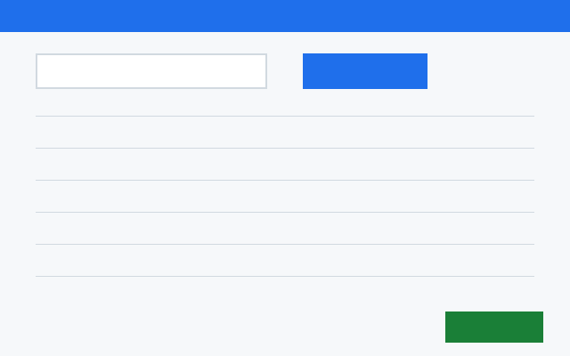

# Registrar um pedido

## Registre o pedido

1. Escolha o cliente.
2. Adicione os itens.
3. Clique em Salvar.

Veja os [estados do pedido](../reference/order-status.md).

## O sistema não me deixa salvar o pedido

O botão Salvar fica desligado enquanto falta o cliente. Escolha o
cliente e o botão liga.
